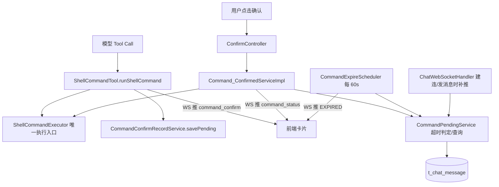

## 产品概述
对现有终端命令确认流程做一次针对性重构：保留“高危命令直接拒绝、修改/删除类命令需用户确认”的分层，补齐 PENDING 记录的 5 分钟超时收敛，并修复“模型只在对话里说需要用户确认、界面上却没有确认卡片”的缺陷。

## 核心功能
- 高危命令（沿用现有 FORBIDDEN_KEYWORDS：format 盘符、rm -rf、cleanmgr 等）直接拒绝，不落库、不弹卡片，返回明确原因。
- 修改/删除/移动/改名等写操作命令：落库为 PENDING 并推送确认卡片，用户点击确认后由后端异步执行并回写终态；未点击则一直挂起。
- 超时收敛：PENDING 超过 5 分钟未确认自动变为 EXPIRED 终态，前端卡片可展示“已超时，请重新发起”，模型在后续上下文中能看到“已超时未执行”的事实，不再催用户点确认。
- 超时后用户再点击确认时明确拒绝执行，并提示重新发起，杜绝“挂了很久的命令突然被执行”。
- 卡片兜底：待确认命令以数据库为准，WebSocket 只是加速通道。连接建立、发送新消息、定时扫描时都能把未过期的待确认命令重新推送一次，解决事件丢失导致的“有文字无卡片”。
- 幻觉纠正：若模型回复中声称“需要用户确认”但本轮并未真实产生待确认记录，后端改写为“命令未成功提交，请重新发送”，并记录告警日志。
- 对外补充“按会话查询待确认命令”的接口，供前端进会话时主动拉取卡片。

## 交互与视觉
命令卡片状态扩展为：待确认、执行中（计时）、执行成功、执行失败、已超时。已超时卡片不可再点击确认，文案明确提示重新发送指令。对话正文不再出现“要求用户点确认”但没有卡片可点的错位场景。


## 技术栈（沿用现状，不引入新依赖）
- Java + Spring Boot 3、Spring AI（Tool 注解）、MyBatis-Plus、MySQL、Spring WebSocket、Spring Scheduling、Lombok。
- 模块依赖方向已定：corepulse-common（配置/事件接口）、corepulse-domain（实体/枚举/Mapper）、corepulse-system（命令工具与执行器）、corepulse-chat（对话编排与确认服务）、corepulse-web（启动类/WebSocket/定时任务）。
- 前端仅有打包产物 frontend-dist，无源码，因此本次改造全部落在后端，前端契约以接口与事件协议的形式输出到文档。

## 实现策略

### 1. 以数据库为唯一事实来源，WebSocket 降级为加速通道
现状问题根因有两条，必须同时覆盖：
- A. 模型幻觉：PromptEnum 把“【需要用户确认，命令尚未执行】”逐字教给了模型，模型可以只复述这句话而不真正调用工具，数据库里没有任何记录，前端自然无卡片。
- B. 事件丢失：`WebSocketSessionManager.send` 在会话不存在或未打开时静默返回，`ChatWebSocketHandler.afterConnectionEstablished` 只注册不补推，前端刷新、断线重连后事件永久丢失。

对策：新增按会话查询有效 PENDING 的接口，并在“WS 建连、发送新消息、定时扫描”三个时机补推卡片事件；同时对模型回复做后置校验，用“库里是否真的有 PENDING 记录”判断它是否在编造。

### 2. 超时采用“惰性判定 + 定时兜底”双保险
- 惰性判定：点确认、模型读上下文、前端查状态时，用 `created_at < now - 5min` 作为 SQL 条件，把过期的 PENDING 条件更新为 EXPIRED，保证任何一次访问都读到正确状态。
- 定时兜底：`@Scheduled(fixedDelay = 60s)` 批量收敛无人访问的旧记录，并向会话推送 `command_status`（status=EXPIRED），让卡片自动停止旋转。
- 不用“只在前端置灰”的方案：后端状态失真会让模型继续在上下文里看到“待确认”，下一轮仍会催确认。

### 3. 状态迁移一律条件更新（幂等）
所有迁移都是 `update ... where id = ? and status = 期望值`：
- PENDING → CONFIRMED（`confirmed = 0` 约束，双击只生效一次）
- CONFIRMED → EXECUTING（抢占执行权）
- PENDING → EXPIRED（`created_at < cutoff` 约束，天然幂等）
- EXECUTING → EXECUTED/FAILED
这样重复点击、模型重试、定时任务与用户点击并发时，只有一条路径能成功，其余路径读到 0 行即放弃，不会重复执行或覆盖别人写好的结果。

### 4. 不从自然语言里反推命令
检测到“模型口头确认”时，只做提示纠正与日志埋点，绝不尝试从回复文本里抽取命令自动补建待确认记录——那会造成“用户确认 A、实际执行 B”的新漏洞，代价远大于让用户重发一次。

### 5. 危险命令边界保持不变
继续用 `FORBIDDEN_KEYWORDS` 兜底拒绝，`ShellCommandExecutor.execute` 内部再拦一次（模型入口与确认入口共用同一处拦截），本次不扩大拒绝范围，删除/改名/移动类仍走确认。

## 性能与可靠性
- 超时判定是主键/条件更新，O(1)；扫描走 `(status, created_at)` 索引，每分钟一次，数据量级为个位数到百条，可忽略。
- 待确认列表按 `session_id` 查询，命中现有 `idx_session(session_id, created_at)`。
- 事件推送失败只记录 warn（现有约定），不影响主流程；状态已落库，前端可通过 `GET /api/Confirmed/{id}` 与新增的 pending 接口自愈。
- 定时任务前提是单实例部署；若将来多实例，用 Redis SETNX 加锁保证只有一个实例扫描，避免重复推送（本次预留说明，不实现）。

## 架构设计


## 目录结构

corepulse-domain/
├── src/main/java/com/corepulse/domain/enums/CommandStatus.java  # [MODIFY] 新增 EXPIRED 常量与注释，说明 PENDING->EXPIRED 为超时终态、不可再执行，并解释为什么不复用 FAILED（区分“没执行”与“执行失败”，否则模型会把超时当成执行失败去分析）

corepulse-common/
├── src/main/java/com/corepulse/common/config/CommandConfirmProperties.java  # [NEW] @ConfigurationProperties(prefix="corepulse.command")，字段 Duration confirmTimeout 默认 5 分钟、Duration sweepInterval 默认 60 秒。放在 common 是因为 system（savePending）与 chat（确认/扫描）都要读同一个超时值，避免两处各写一份常量

corepulse-chat/
├── src/main/java/com/corepulse/chat/service/CommandPendingService.java  # [NEW] 待确认命令统一门面：listValidPending(sessionId) 返回未超时 PENDING；expireIfTimeout(messageId) 条件更新为 EXPIRED 并返回是否本次生效；expireBatch(cutoff) 返回本次被置为 EXPIRED 的记录列表供推送。超时判定全部用 SQL 条件，不依赖实体字段（MyBatis-Plus 插入后不回填 createdAt）
├── src/main/java/com/corepulse/chat/service/impl/CommandPendingServiceImpl.java  # [NEW] 上面接口的实现，依赖 ChatMessageMapper 与 CommandConfirmProperties
├── src/main/java/com/corepulse/chat/model/vo/PendingCommandVO.java  # [NEW] 卡片兜底数据：messageId、command、status、createdAt、expiresAt，供前端直接渲染
├── src/main/java/com/corepulse/chat/controller/ConfirmController.java  # [MODIFY] 新增 GET /api/Confirmed/pending?sessionId=，返回该会话有效待确认列表；保留现有单条确认与单条状态查询
├── src/main/java/com/corepulse/chat/service/impl/Command_ConfirmedServiceImpl.java  # [MODIFY] 入口先做超时判定（过期则置 EXPIRED 并返回“命令已超时失效，请重新发起”）；抢执行权后再校验一次；queryStatus 兼容 EXPIRED
├── src/main/java/com/corepulse/chat/service/impl/ChatServiceImpl.java  # [MODIFY] 1) buildMessages 增加 EXPIRED 分支，还原为“[命令已超时未执行] …（用户未在 5 分钟内确认，命令已失效，如需执行请重新发起）”；2) saveToolRecords 返回本轮是否真实产生过“需要用户确认”结果；3) 回复后置校验：含确认标记但库中无有效 PENDING 时改写回复并 warn 日志
├── src/main/java/com/corepulse/chat/Enum/PromptEnum.java  # [MODIFY] 删除逐字返回话术，改为“是否可以说需要确认，以工具真实返回为准；禁止自行编造确认标记，禁止在未调用工具时写出命令让用户确认”

corepulse-system/
├── src/main/java/com/corepulse/system/tool/CommandConfirmRecordService.java  # [MODIFY] savePending 复用条件加 created_at >= 超时截止时间，避免复用一条马上要过期的旧记录；插入时显式 set createdAt，保证实体时间与库一致
├── src/main/java/com/corepulse/system/tool/ShellCommandTool.java  # [MODIFY] 待确认返回文案去掉易被模型复述的固定格式细节，改为明确“系统已生成待确认记录（ID），该标记只能由工具产生”，并保持落库与推送顺序不变

corepulse-web/
├── src/main/java/com/corepulse/CorePulseApplication.java  # [MODIFY] 增加 @EnableScheduling（当前工程没有任何定时任务，需显式开启）
├── src/main/java/com/corepulse/web/scheduler/CommandExpireScheduler.java  # [NEW] fixedDelay 读配置，调用 CommandPendingService.expireBatch，对被收敛的记录逐条通过 CommandConfirmNotifier 推送 command_status（EXPIRED，摘要“命令已超时未执行”）；异常自行捕获，避免调度线程被异常终止
├── src/main/java/com/corepulse/web/websocket/ChatWebSocketHandler.java  # [MODIFY] afterConnectionEstablished 注册成功后，查询该会话有效 PENDING 并补推 command_confirm，修复刷新/重连丢卡片；注入 chat 模块的 CommandPendingService（web 已依赖 chat）
├── src/main/resources/application.yml  # [MODIFY] 新增 corepulse.command.confirm-timeout: 5m、sweep-interval: 60s 配置项与注释

sql/
├── schema.sql  # [MODIFY] status 注释补充 EXPIRED，并新增 KEY idx_status_created (status, created_at)；同时给出已有库的 ALTER TABLE 语句，便于用户本地升级

doc/
├── 架构设计.md  # [MODIFY] 补充完整状态机（含 EXPIRED）、新接口、WS 事件协议（command_confirm / command_status 的 status 取值），说明前端如何做超时置灰与进会话拉取
```

## 关键代码结构
```java
public enum CommandStatus {
    PENDING("PENDING"), CONFIRMED("CONFIRMED"), EXECUTING("EXECUTING"),
    EXECUTED("EXECUTED"), FAILED("FAILED"),
    /** 超过确认时限未被用户确认：未执行、不可再执行（终态） */
    EXPIRED("EXPIRED");
}

public interface CommandPendingService {
    List<PendingCommandVO> listValidPending(Long sessionId);
    boolean expireIfTimeout(Long messageId);
    List<ChatMessage> expireBatch(LocalDateTime cutoff);
}
```

## 实施要点
- 超时基准用数据库 `created_at`，条件写成 `created_at < :cutoff`，不要读实体 `getCreatedAt()` 判空后自行比较。
- 事件推送必须在状态提交之后，保持“前端收到事件立刻回查也能读到一致状态”的既有约定。
- 日志沿用现有风格：记录 messageId、status、耗时、退出码，不打印完整命令输出（输出可能含用户路径），摘要统一走 `ShellCommandExecutor.summarize` 截断。
- 不修改 frontend-dist 打包产物；前端对新状态与补推事件的适配写入文档，由用户按需实现。
- 保持现有方法签名与 Controller 路径不变，只做增量改动，避免影响已跑通的确认/执行链路。


## Agent Extensions
### Skill
- **lsp-code-analysis**
  - Purpose: 在改造前用 LSP 精确查找 `CommandStatus` 枚举与 `status` 字段的全部引用点（含 ShellCommandTool、ChatServiceImpl、Command_ConfirmedServiceImpl），确认新增 EXPIRED 后所有分支都被覆盖，避免遗漏状态判断导致模型误判
  - Expected outcome: 得到一份完整的引用清单，作为改造核对表，确保每个 status 分支都显式处理 EXPIRED
